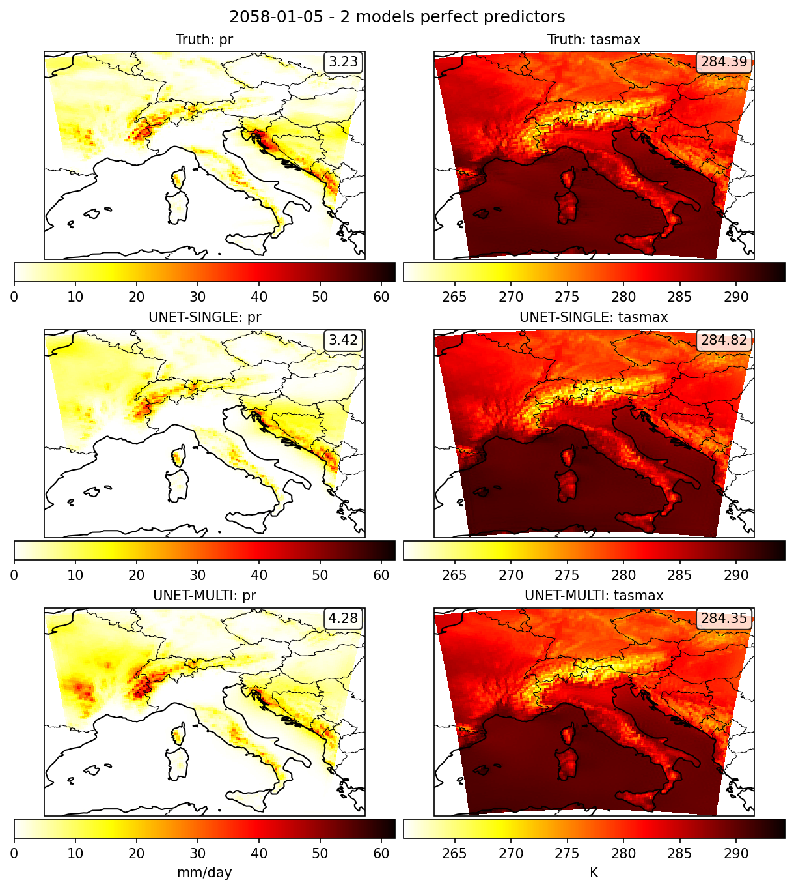
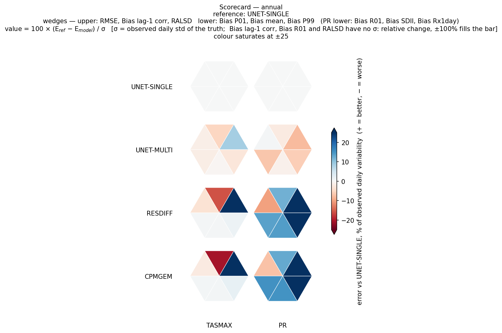
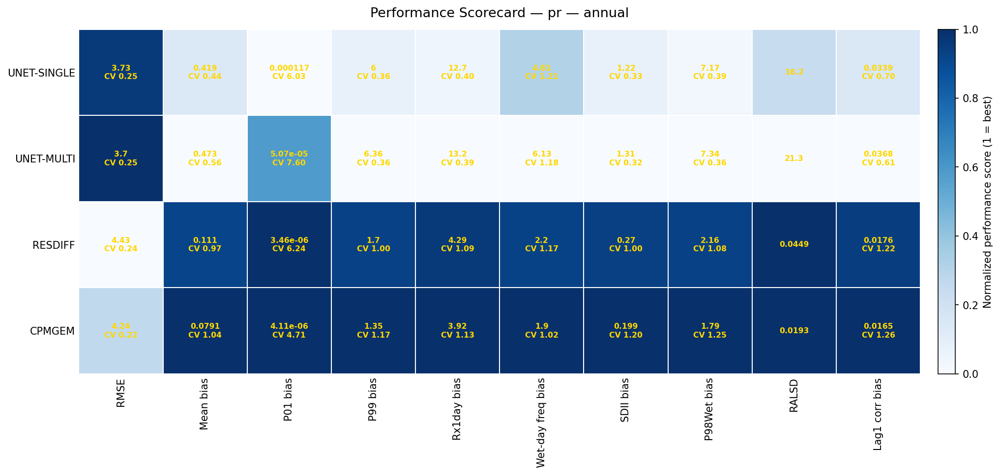
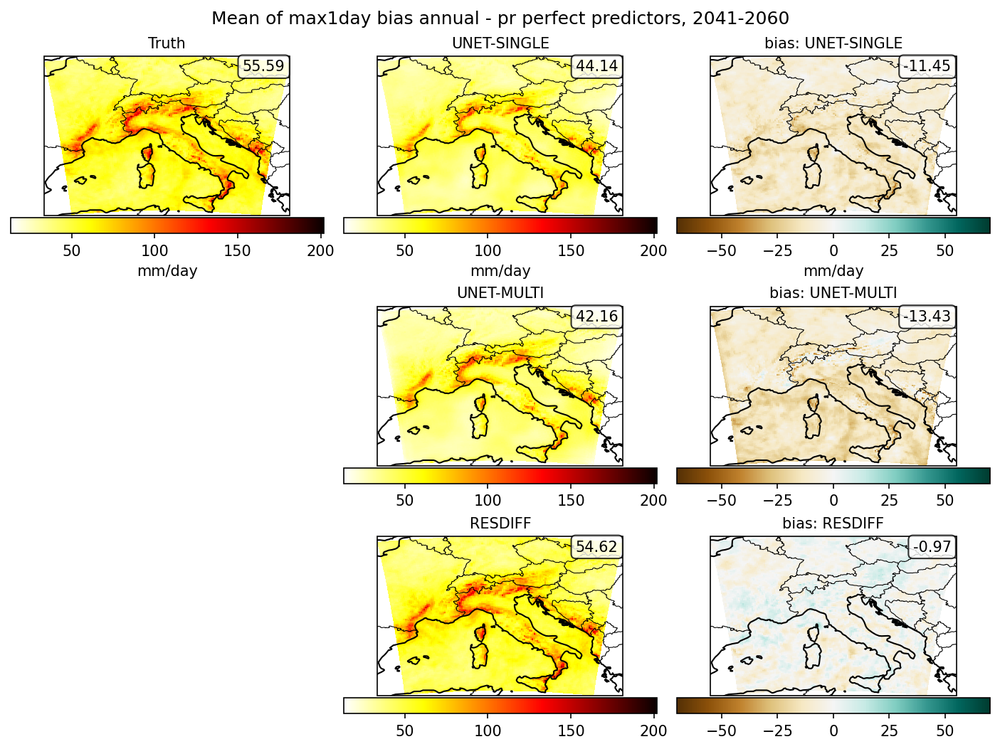
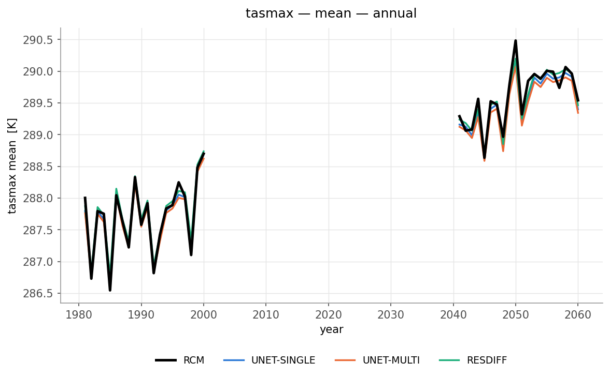
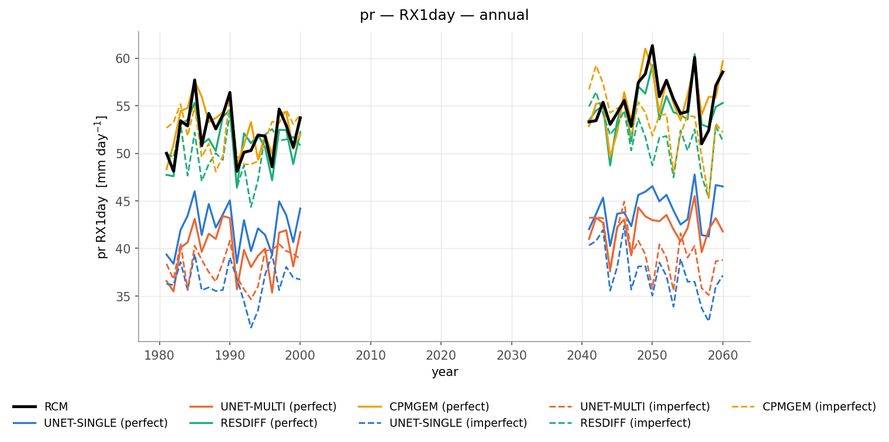
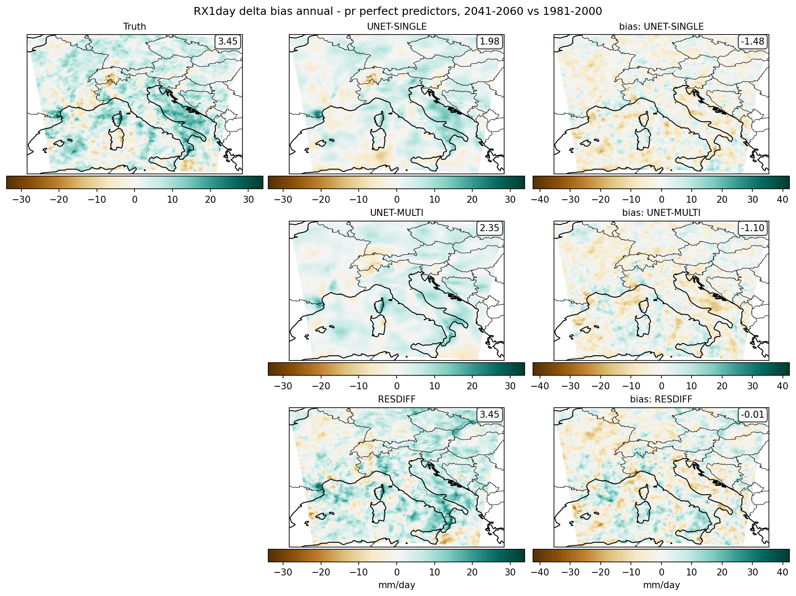
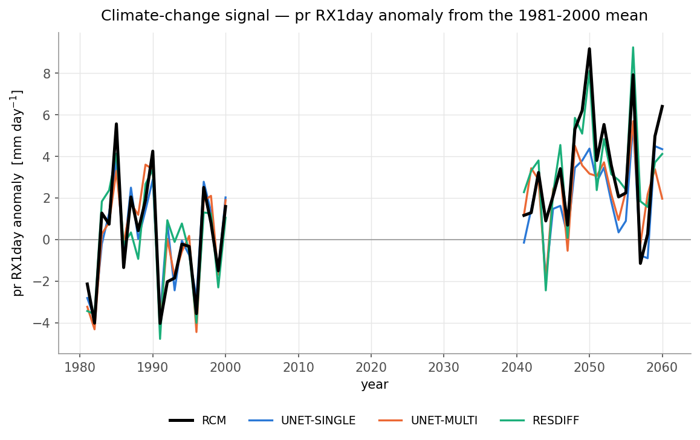

# ML-Evaluation Tutorial: CORDEX-BENCH Alps Case Study

This tutorial demonstrates how to use the [ml-evaluation](https://github.com/c3s-cordex-ml/ml-evaluation) package to evaluate machine-learning RCM (Regional Climate Model) emulators, using the **CORDEX-BENCH Alps** domain as a case study. We walk through the full workflow: running the `ml-eval` command-line tracks (`fast`, `slow`, `signal`, `prob`) on a set of emulator predictions, and turning the resulting metric stores into **scorecards** with `ml_evaluation.viz`.

The emulators scored here (UNET-MULTI, UNET-SINGLE, RESDIFF, CPMGEM) are trained and run with [deep4production](https://github.com/SantanderMetGroup/deep4production) on the *same* case study, so the two packages compose end to end: `d4p-train` → `d4p-downscale` → `ml-eval` → scorecard.

> **Where the predictions come from.** This tutorial starts from NetCDF predictions that already exist on disk. To (re)produce them yourself, follow the deep4production tutorials on the same Alps case:
>
> - **UNET-SINGLE / UNET-MULTI** — a deterministic SongUNet trained in regression mode (`trainer_song_unet_det`). deep4production has no standalone tutorial for it; the recipe is [step 6.1 of the ResDiff tutorial](https://github.com/SantanderMetGroup/deep4production/blob/master/notebooks/Deep4Production%20Tutorial%3A%20CORDEX-BENCH%20Alps%20Case%20Study%20with%20ResDiff.md#61-step-1--train-the-deterministic-songunet-regressor), where the same network is trained as ResDiff's first stage. Used on its own it is an emulator in its own right: that YAML, run as-is, gives UNET-SINGLE for one predictand; listing every predictand in `data.predictands.variables` (and matching `in_channels`) gives UNET-MULTI.
> - **RESDIFF** — the two-stage CorrDiff-style residual diffusion emulator: [ResDiff tutorial](https://github.com/SantanderMetGroup/deep4production/blob/master/notebooks/Deep4Production%20Tutorial%3A%20CORDEX-BENCH%20Alps%20Case%20Study%20with%20ResDiff.md).
> - **CPMGEM** — the single-stage (direct) diffusion emulator: [CPMGEM tutorial](https://github.com/SantanderMetGroup/deep4production/blob/master/notebooks/Deep4Production%20Tutorial%3A%20CORDEX-BENCH%20Alps%20Case%20Study%20with%20CPMGEM.md).
> - The framework itself (project structure, `d4p-create`, `d4p-inspect`, `d4p-train`, `d4p-downscale`): [DeepESD tutorial](https://github.com/SantanderMetGroup/deep4production/blob/master/notebooks/Deep4Production%20Tutorial%3A%20CORDEX-BENCH%20Alps%20Case%20Study%20with%20DeepESD.md).

______________________________________________________________________

## 1. Introduction

### Two core concepts

- **Indices** describe *one* simulation `x` — its climatological mean, a percentile, wet-day frequency, an annual maximum, a lag-1 autocorrelation.
- **Diagnostics** compare *two* simulations: the reference `x0` (ground truth — the target RCM) against the prediction `x1` (the emulator output) — e.g. mean bias, RMSE, RALSD, Wasserstein distance.

`ml-evaluation` builds on the indices and diagnostics available in [CORDEX-BENCH](https://github.com/WCRP-CORDEX/ml-benchmark) and extends them. They are grouped in seven categories:

**accuracy** · **distribution** · **extremes** · **temporal coherence** · **spatial coherence** · **multivariate coherence** · **probabilistic skill**

### Installation

Either environment manager works; both give you the `ml-eval` executable.

```bash
# Option A — pixi
pixi install
pixi shell -e dev

# Option B — conda
conda env create -f environment.yaml
conda activate rcm-emulation
pip install -e .
```

Check the CLI is on the PATH:

```bash
ml-eval --help
ml-eval fast --help
```

Anywhere below, `ml-eval <track>` can be replaced by `pixi run -e dev python -m ml_evaluation.cli <track>` if you prefer not to activate an environment.

______________________________________________________________________

## 2. Case study: CORDEX-BENCH Alps

The same simplified CORDEX-BENCH configuration used by the deep4production tutorials, extended to the **emulation** test periods:

- **Domain:** Central Europe (Alps), 128 × 128 grid boxes at 0.11°
- **Target RCM (ground truth):** CNRM-CM5-ALADIN-63, referred to as **RCM**
- **Predictors:** upscaled RCM (**UPSRCM**, 16 × 16, `u/v/t/q/z` at 850/700/500 hPa) for the *perfect* framework; the raw driving GCM (CNRM-CM5) for the *imperfect* framework
- **Predictands:** `pr` (precipitation, mm day⁻¹) and `tasmax` (daily maximum temperature, K)
- **Training:** 1961-1980 · **Test:** historical 1981-2000 and mid-century 2041-2060

Four emulators are scored, all trained on the same data:

| Label | What it is | deep4production tutorial |
|---|---|---|
| `UNET-SINGLE` | deterministic SongUNet, **one network per predictand** | [ResDiff tutorial, §6.1](https://github.com/SantanderMetGroup/deep4production/blob/master/notebooks/Deep4Production%20Tutorial%3A%20CORDEX-BENCH%20Alps%20Case%20Study%20with%20ResDiff.md#61-step-1--train-the-deterministic-songunet-regressor) |
| `UNET-MULTI` | deterministic SongUNet, **one network for all predictands** | [ResDiff tutorial, §6.1](https://github.com/SantanderMetGroup/deep4production/blob/master/notebooks/Deep4Production%20Tutorial%3A%20CORDEX-BENCH%20Alps%20Case%20Study%20with%20ResDiff.md#61-step-1--train-the-deterministic-songunet-regressor) |
| `RESDIFF` | two-stage residual diffusion (regressor + EDM residual) | [ResDiff tutorial](https://github.com/SantanderMetGroup/deep4production/blob/master/notebooks/Deep4Production%20Tutorial%3A%20CORDEX-BENCH%20Alps%20Case%20Study%20with%20ResDiff.md) |
| `CPMGEM` | single-stage (direct) diffusion | [CPMGEM tutorial](https://github.com/SantanderMetGroup/deep4production/blob/master/notebooks/Deep4Production%20Tutorial%3A%20CORDEX-BENCH%20Alps%20Case%20Study%20with%20CPMGEM.md) |

The two U-Nets share one tutorial section: they are the same deterministic SongUNet recipe, differing only in whether the predictands are trained one network per variable or jointly in a multi-channel output. That section appears inside the ResDiff tutorial because ResDiff reuses the same network as its first stage — but trained and run on its own, it is a standalone emulator.

`UNET-SINGLE` is the **baseline** the skill scorecards are referenced against; the `RCM` itself is published as a fifth "simulation" and is the reference row of the climate-change-signal scorecards.

______________________________________________________________________

## 3. What `ml-eval` expects, and where things live

### 3.1 Input files

Every track needs plain **NetCDF** files containing the variable named by `--var`:

- **`--x0`** — the reference (target RCM).
- **`--x1`** — the prediction (emulator output).

Predictions written by `d4p-downscale` **with a template** (`saving_info.template`) already have the right shape — the template carries the target grid, so prediction and reference are directly comparable:

```
Dimensions:  (member: 1, time: 7305, y: 128, x: 128)
Coordinates:
  * member   (member) int64 0
  * time     (time) datetime64[ns] 2041-01-01T12:00:00 ... 2060-12-31T12:00:00
    lon      (y, x) float64 ...
    lat      (y, x) float64 ...
Data variables:
    tasmax   (member, time, y, x) float32 ...
    pr       (member, time, y, x) float32 ...
```

Notes:

- **Spatial dims** may be `(lat, lon)` on a regular grid or `(y, x)` with 2-D `lat`/`lon` coordinates on a curvilinear one (the Alps case) — `ml-eval` detects which and reduces over the right pair.
- **`member`** is optional. A deterministic emulator has `member: 1`; a generative one has as many members as `ensemble_size` in its inference YAML. By default every member is scored separately and the metrics carry a `member` dimension; `--member-num n` scores member *n* only, and `--member-num -1` scores the ensemble mean.
- **Units** must match between `--x0` and `--x1`. Here both are `mm day-1` for `pr` and `K` for `tasmax`. Hard-coded physical thresholds (1 mm/day for wet days, 25 °C for summer days, …) are rescaled internally to the units of the data, so no manual conversion is needed. As a safety net, `fast`/`prob` divide `pr` by 86400 if the prediction looks like mm/day while the reference looks like kg m⁻² s⁻¹, and print a warning when they do.

### 3.2 Directory convention

`ml-eval` itself is **layout-agnostic** — a call needs only `--x0`, `--x1`, `--var` and `--output`. The convention below is the one used by the CORDEX-BENCH-ALPS project, and it is what `ml_evaluation.viz` assumes when you hand it a run directory (viz appends `<var>` itself):

```
CORDEX-BENCH-ALPS/
├── SOURCE_FILES/data_zenodo/ALPS_domain/
│   ├── train/                                   ESD_pseudo_reality, Emulator_hist_future
│   └── test/{historical,mid_century,end_century}/{predictors,target}/
│
├── SIMULATIONS/
│   ├── RCM/                                     the ground truth, published as a "simulation"
│   │   ├── collect_targets.sh                   copies SOURCE_FILES targets into predictions/
│   │   ├── evaluation.sh                        ml-eval signal for the RCM truth (reference row)
│   │   └── outputs/
│   │       ├── predictions/<RCM>_<GCM>_<PERIOD>.nc                        <- x0
│   │       └── evaluation/rcm/<RCM>_<GCM>_<PERIOD>/<SEASON>/<VAR>/
│   │
│   └── <EMULATOR>/                              UNET-MULTI, UNET-SINGLE, RESDIFF, CPMGEM
│       ├── train.yaml, inference.yaml           (deep4production)
│       ├── evaluation.sh                        the ml-eval driver for this emulator
│       └── outputs/
│           ├── predictions/<CKPT>_<RCM>_<TRAIN_GCM>_<DATASET>_<PERIOD>.nc  <- x1
│           └── evaluation/<CKPT>/<CKPT>_<RCM>_<TRAIN_GCM>_<DATASET>_<PERIOD>/<SEASON>/<VAR>/
│               ├── metrics_fast_*.zarr
│               ├── metrics_slow_*.zarr
│               ├── metrics_signal_*.zarr
│               └── metrics_prob_*.zarr
│
└── FIGURES/<figure>/plot.sh                     one script per figure, writes the PNG next to itself
```

Two conventions worth keeping:

1. **The evaluation run id is the prediction file's stem.** Every metric describing one prediction file sits in one directory, so a figure script can find it from the model name alone. `<DATASET>` is the 4th field: `UPS-<RCM>-<GCM>` for the perfect framework, `<GCM>` for the imperfect one.
1. **The RCM truth is a simulation like any other.** `collect_targets.sh` copies the targets into `SIMULATIONS/RCM/outputs/predictions/` under the common naming, so `--x0` is resolved exactly like `--x1`. Its name carries no `perfect`/`imperfect` field — the RCM is boundary-independent.

______________________________________________________________________

## 4. The `ml-eval` tracks at a glance

| Track | Key arguments | Metrics computed | Output stores (`.zarr`) |
|---|---|---|---|
| **`fast`** (basic) | `--x0` truth<br>`--x1` prediction<br>`--var` | RMSE (field and domain scalar); bias of climatological mean, P01, P99, annual max/min, lag-1 autocorrelation; RAPSD + RALSD.<br>`pr` also: P98wet, R01, SDII biases (+ relative-bias variants of P98wet, SDII, Rx1day) | `metrics_fast_field`<br>`metrics_fast_float`<br>`metrics_fast_psd`<br>`metrics_fast_pr_field` (`--var pr`) |
| **`slow`** (extended) | `--x0` truth<br>`--x1` prediction<br>`--var` | Bias of interannual variability and P90; Wasserstein distance (direct and histogram-based), PSS, LHD, FCSS; Pearson/Spearman correlation over time; pattern RMSE and correlation per timestep; full histograms.<br>`pr`: P90wet, R10, CDD, CWD. `tasmax`: summer/hot/ice days. `tasmin`: tropical nights, frost days | `metrics_slow_field`<br>`metrics_slow_series`<br>`metrics_slow_hist`<br>`metrics_slow_{pr,tasmax,tasmin}_field` |
| **`signal`** | `--hist` historical<br>`--fut` future<br>`--var` | Absolute (`delta`) and relative (`reldelta`) change, future − historical, of: mean, P01, P99 (`pr`: R01, SDII, Rx1day) — as maps, annual series, monthly cycle and domain scalars | `metrics_signal_field`<br>`metrics_signal_series`<br>`metrics_signal_month`<br>`metrics_signal_float` |
| **`multivar`** | `--x0`, `--x1`<br>`--var`, `--var2` | Bias of the Pearson and Spearman correlation between two predicted variables | `metrics_mv_field` |
| **`prob`** | `--x0` truth<br>`--x1` ensemble prediction<br>`--var` | CRPS, Brier score for the > P50 event, spread–error ratio (the last only when the prediction has ≥ 2 members) | `metrics_prob_field`<br>`metrics_prob_float` |

Options shared by every track: `--output` (directory, file prefix, or an explicit `.zarr` path), `--season` (`DJF`/`MAM`/`JJA`/`SON` or a month name; omit for whole-year), `--align-leap-days` (reconcile calendar mismatches), `--force-load` (pull the lazy arrays into memory — handy on small test data), `--use-dask` (parallel, out-of-core), and `--member-num` (every track except `prob`, which needs the full ensemble).

Inside every store the metrics are stacked as a single `value` variable indexed by a **`diagnostic`** coordinate, so a metric is selected with `ds["value"].sel(diagnostic="<name>")`. Stores are split by *shape*: `_field` are maps, `_series` are time axes, `_float` are domain scalars, `_hist` are histograms, `_psd` are spectra.

______________________________________________________________________


The four tracks used in this tutorial are covered one by one below; `multivar` follows the same pattern with a second `--var2` and is only meaningful for a multivariate emulator (here it would compare, e.g., `pr` against `tasmax`).

### 4.1 The basic track: `ml-eval fast`

The cheap, single-pass statistics that feed the scorecards. One call scores one (prediction, variable, season):

All commands and scripts below are run **from the project root** (`CORDEX-BENCH-ALPS/`), so every path is relative to it.

```bash
SIM=./SIMULATIONS

ml-eval fast \
    --x0 $SIM/RCM/outputs/predictions/CNRM-ALADIN63_CNRM-CM5_2041-2060.nc \
    --x1 $SIM/UNET-MULTI/outputs/predictions/UNET-MULTI_CNRM-ALADIN63_CNRM-CM5_UPS-CNRM-ALADIN63-CNRM-CM5_2041-2060.nc \
    --var pr \
    --output $SIM/UNET-MULTI/outputs/evaluation/UNET-MULTI/UNET-MULTI_CNRM-ALADIN63_CNRM-CM5_UPS-CNRM-ALADIN63-CNRM-CM5_2041-2060/annual/pr
```

Add `--season JJA` for a summer-only version of every metric in the call (the flag is threaded into each diagnostic, so one invocation gives either the annual or the seasonal variant of the whole battery).

#### What it writes

| Store | `value` dims | `diagnostic` entries |
|---|---|---|
| `metrics_fast_field.zarr` | (diagnostic, member, y, x) | `rmse_field`, `bias_mean_field`, `bias_p99_field`, `bias_p1_field`, `bias_acorr_field`, `bias_max1day_field`, `bias_min1day_field`, plus the underlying `targ_*_field` / `pred_*_field` indices |
| `metrics_fast_float.zarr` | (diagnostic, member) | `rmse_float`, `ralsd_float` |
| `metrics_fast_psd.zarr` | (diagnostic, wavenumber, member) | `psd_x0`, `psd_x1` |
| `metrics_fast_pr_field.zarr` | (diagnostic, member, y, x) | `bias_p98wet_field`, `bias_r1_field`, `bias_sdii_field`, `relbias_p98wet_field`, `relbias_sdii_field`, `relbias_rx1day_field`, plus `targ_*` / `pred_*` |

The `member` dimension is always present (length 1 for a deterministic emulator, unless `--member-num` collapsed it), so a metric of a generative emulator keeps one value per realisation. Storing the target and prediction indices next to the bias (`targ_mean_field`, `pred_mean_field`, …) means the maps behind a score can be plotted without recomputing anything.

#### Reading the results back

```python
import os
import numpy as np
import xarray as xr

CELL = ("./SIMULATIONS/UNET-MULTI/outputs/evaluation/UNET-MULTI/"
        "UNET-MULTI_CNRM-ALADIN63_CNRM-CM5_UPS-CNRM-ALADIN63-CNRM-CM5_2041-2060/"
        "annual/pr")

# 1) domain scalars
floats = xr.open_zarr(os.path.join(CELL, "metrics_fast_float.zarr"))["value"]
print(floats["diagnostic"].values)                    # ['rmse_float' 'ralsd_float']
rmse = float(floats.sel(diagnostic="rmse_float"))
ralsd = float(floats.sel(diagnostic="ralsd_float"))

# 2) a bias map, and the same reduction the scorecards use: mean(|field|)
fields = xr.open_zarr(os.path.join(CELL, "metrics_fast_field.zarr"))["value"]
bias_mean_map = fields.sel(diagnostic="bias_mean_field")        # (y, x)
bias_mean = float(np.abs(bias_mean_map).mean())

# 3) precip-only diagnostics (present because --var pr)
pr = xr.open_zarr(os.path.join(CELL, "metrics_fast_pr_field.zarr"))["value"]
sdii_bias = float(np.abs(pr.sel(diagnostic="bias_sdii_field")).mean())

print(f"RMSE={rmse:.3g}  RALSD={ralsd:.3g}  |bias mean|={bias_mean:.3g}  |bias SDII|={sdii_bias:.3g}")
```

Every scorecard metric is an **error** (lower is better): spatial biases are reduced to a domain scalar as `mean(|field|)`, RMSE and RALSD are already scalars.

______________________________________________________________________

### 4.2 The extended track: `ml-eval slow`

The distributional and spectral diagnostics, computed per grid point. Considerably more expensive, so in this case study it is run for precipitation only:

```bash
ml-eval slow \
    --x0 $SIM/RCM/outputs/predictions/CNRM-ALADIN63_CNRM-CM5_2041-2060.nc \
    --x1 $SIM/RESDIFF/outputs/predictions/RESDIFF600_CNRM-ALADIN63_CNRM-CM5_UPS-CNRM-ALADIN63-CNRM-CM5_2041-2060.nc \
    --var pr \
    --output $SIM/RESDIFF/outputs/evaluation/RESDIFF600/RESDIFF600_CNRM-ALADIN63_CNRM-CM5_UPS-CNRM-ALADIN63-CNRM-CM5_2041-2060/annual/pr \
    --use-dask
```

Write the output to the **same leaf directory** as the `fast` call for that prediction and variable: the per-variable scorecard reads fast- and slow-track columns from one directory.

| Store | `value` dims | `diagnostic` entries |
|---|---|---|
| `metrics_slow_field.zarr` | (diagnostic, member, y, x) | `bias_annstd_field`, `bias_p90_field`, `wd_field`, `wdh_field`, `fcss_field`, `pss_field`, `lhd_field`, `pcorr_field`, `scorr_field` (+ `targ_*` / `pred_*`) |
| `metrics_slow_series.zarr` | (diagnostic, member, time) | `rmse_series`, `pcorr_series`, `scorr_series` — spatial statistics per timestep |
| `metrics_slow_hist.zarr` | (diagnostic, bins, member) | `targ_hist_series`, `pred_hist_series`, `bins_hist_series` + the domain-wide scores `wdh_float`, `fcss_float`, `pss_float`, `lhd_float` |
| `metrics_slow_pr_field.zarr` | (diagnostic, member, y, x) | `bias_p90wet_field`, `bias_r10_field`, `bias_cdd_field`, `bias_cwd_field`, `relbias_p90wet_field` (+ `targ_*` / `pred_*`) |
| `metrics_slow_tasmax_field.zarr` | (diagnostic, member, y, x) | `bias_su_field` (≥ 25 °C), `bias_hot_field` (≥ 35 °C), `bias_ice_field` (< 0 °C) |
| `metrics_slow_tasmin_field.zarr` | (diagnostic, member, y, x) | `bias_tropnight_field` (≥ 20 °C), `bias_frost_field` (< 0 °C) |

The `_hist` store is what you plot to compare *whole distributions* rather than selected quantiles:

```python
h = xr.open_zarr(os.path.join(CELL, "metrics_slow_hist.zarr"))["value"]
bins = h.sel(diagnostic="bins_hist_series")
truth = h.sel(diagnostic="targ_hist_series")
pred = h.sel(diagnostic="pred_hist_series")
wd = float(h.sel(diagnostic="wdh_float"))          # Wasserstein distance, data units
```

______________________________________________________________________

### 4.3 The climate-change signal: `ml-eval signal`

`signal` is deliberately **source-agnostic**: it takes a historical and a future file *for one source* and computes the change between them. It never sees the ground truth. The signal *bias* is obtained downstream by comparing two such bundles (in the scorecard), which keeps every model's signal referenced to its own historical baseline — and thereby removes any bias inherited from the driving GCM.

For one emulator:

```bash
CKPT_DIR=$SIM/RESDIFF/outputs/evaluation/RESDIFF600/RESDIFF600_CNRM-ALADIN63_CNRM-CM5_UPS-CNRM-ALADIN63-CNRM-CM5_2041-2060/annual/pr

ml-eval signal \
    --hist $SIM/RESDIFF/outputs/predictions/RESDIFF600_CNRM-ALADIN63_CNRM-CM5_UPS-CNRM-ALADIN63-CNRM-CM5_1981-2000.nc \
    --fut  $SIM/RESDIFF/outputs/predictions/RESDIFF600_CNRM-ALADIN63_CNRM-CM5_UPS-CNRM-ALADIN63-CNRM-CM5_2041-2060.nc \
    --var pr \
    --output $CKPT_DIR
```

And **once** for the RCM truth, which becomes the reference row of the signal scorecard:

```bash
ml-eval signal \
    --hist $SIM/RCM/outputs/predictions/CNRM-ALADIN63_CNRM-CM5_1981-2000.nc \
    --fut  $SIM/RCM/outputs/predictions/CNRM-ALADIN63_CNRM-CM5_2041-2060.nc \
    --var pr \
    --output $SIM/RCM/outputs/evaluation/rcm/CNRM-ALADIN63_CNRM-CM5_2041-2060/annual/pr
```

The index set is `mean`/`p01`/`p99` for most variables and `r01`/`sdii`/`rx1day` for precipitation. Each index is stored twice — an absolute `delta` and a relative `reldelta` — across four stores:

| Store | `value` dims | `diagnostic` entries |
|---|---|---|
| `metrics_signal_field.zarr` | (diagnostic, y, x) | `delta_<index>_field`, `reldelta_<index>_field` |
| `metrics_signal_series.zarr` | (diagnostic, year) | `<index>_series` — the raw annual domain-mean over hist+fut on one `year` axis |
| `metrics_signal_month.zarr` | (diagnostic, month) | `delta_<index>_month`, `reldelta_<index>_month` — the seasonally-resolved signal, always all 12 months |
| `metrics_signal_float.zarr` | (diagnostic,) | `delta_<index>_float`, `reldelta_<index>_float` — signed domain means |

Note the sign convention: unlike the skill tracks, signal diagnostics are **signed** — a delta is a change, not an error, so it is never reduced with an absolute value.

______________________________________________________________________

### 4.4 Probabilistic skill: `ml-eval prob`

`prob` assesses an **ensemble** prediction: whether it captures the truth (CRPS), whether it gets threshold events right (Brier score for the > P50 event), and whether its spread reflects its error (spread–error ratio, SERAT). It is a separate track because the spread statistics are undefined for a single member.

Generative emulators produce an ensemble by drawing several samples per date. In deep4production this is one line of the inference YAML:

```yaml
##### ENSEMBLE SIZE #####
# Each reverse-diffusion trajectory draws fresh noise, so ensemble_size > 1
# produces independent realisations of the same day.
ensemble_size: 10
```

Re-run `d4p-downscale ./resdiff/inference.yaml` and the prediction comes back with `member: 10`. Then:

```bash
ml-eval prob \
    --x0 $SIM/RCM/outputs/predictions/CNRM-ALADIN63_CNRM-CM5_2041-2060.nc \
    --x1 $SIM/RESDIFF/outputs/predictions/RESDIFF600_CNRM-ALADIN63_CNRM-CM5_UPS-CNRM-ALADIN63-CNRM-CM5_2041-2060.nc \
    --var pr \
    --output $CKPT_DIR
```

| Store | `value` dims | `diagnostic` entries |
|---|---|---|
| `metrics_prob_field.zarr` | (diagnostic, y, x) | `crps_mean_field`, `bs50p_field`, `se_ssrat_field` |
| `metrics_prob_float.zarr` | (diagnostic,) | `crps_mean_float`, `bs50p_float`, `se_ssrat_float` |

Reading the interpretation right:

- **CRPS** and **BS** are errors — lower is better. On a **single-member** prediction (the deterministic UNETs) they still compute, degenerating to the mean absolute error and the 0/1 indicator loss respectively, which is what makes deterministic and generative emulators comparable on these two columns. The CLI prints a warning and drops the `se_ssrat_*` diagnostics in that case.
- **SERAT** is not an error: it is best at **1**. Under-dispersive ensembles score below 1, over-dispersive above. When ranking models on it, transform first — `|log10(SERAT)|` turns it into a lower-is-better quantity.

```python
p = xr.open_zarr(os.path.join(CELL, "metrics_prob_float.zarr"))["value"]
print(p["diagnostic"].values)
crps = float(p.sel(diagnostic="crps_mean_float"))
serat = float(p.sel(diagnostic="se_ssrat_float"))
print(f"CRPS={crps:.3g} mm/day   SERAT={serat:.2f} "
      f"({'under' if serat < 1 else 'over'}-dispersive)")
```

______________________________________________________________________

## 5. Scoring a whole emulator in one script

In practice you never call `ml-eval` by hand: each emulator carries an `evaluation.sh` that loops the tracks over its checkpoints and variables and writes everything into its own `outputs/evaluation/` tree. Condensed, that driver is:

```bash
#!/bin/bash
# SIMULATIONS/RESDIFF/evaluation.sh — score one emulator on the reference case.
# Run from the project root: bash SIMULATIONS/RESDIFF/evaluation.sh
SIM_DIR=./SIMULATIONS

# ---------------------------- PARAMETERS ------------------------------------
EMULATOR="RESDIFF"
CHECKPOINTS=("RESDIFF600")     # prediction-file prefixes, one per checkpoint to score
RCM="CNRM-ALADIN63"            # target RCM
TRAIN_GCM="CNRM-CM5"           # GCM the emulator was trained on
DRIVING_GCM="CNRM-CM5"         # GCM driving the case being scored
CASE="perfect"                 # perfect = upscaled RCM input, imperfect = raw GCM
PERIOD="2041-2060"
HIST_PERIOD="1981-2000"
VARS=("pr" "tasmax")
SLOW_VARS=("pr")               # the extended track only where it is worth the cost
SEASON="annual"

# ---------------------------- RESOLVE PATHS ---------------------------------
DATASET="$([ "$CASE" = perfect ] && echo "UPS-${RCM}-${DRIVING_GCM}" || echo "${DRIVING_GCM}")"
[ "$SEASON" = "annual" ] && SEASON_FLAG="" || SEASON_FLAG="--season $SEASON"

rcm_file()  { echo "$SIM_DIR/RCM/outputs/predictions/${RCM}_${DRIVING_GCM}_${1}.nc"; }
pred_file() { echo "$SIM_DIR/$EMULATOR/outputs/predictions/${1}_${RCM}_${TRAIN_GCM}_${DATASET}_${2}.nc"; }
eval_dir()  { echo "$SIM_DIR/$EMULATOR/outputs/evaluation/$1/${1}_${RCM}_${TRAIN_GCM}_${DATASET}_${PERIOD}/$SEASON/$2"; }

REF="$(rcm_file "$PERIOD")"

# ---------------------------- RUN -------------------------------------------
for CKPT in "${CHECKPOINTS[@]}"; do
    PRED="$(pred_file "$CKPT" "$PERIOD")"
    PRED_HIST="$(pred_file "$CKPT" "$HIST_PERIOD")"

    for var in "${VARS[@]}"; do
        OUT="$(eval_dir "$CKPT" "$var")"; mkdir -p "$OUT"

        # basic track — the six scorecard metrics
        ml-eval fast --x0 "$REF" --x1 "$PRED" --var "$var" --output "$OUT" $SEASON_FLAG

        # extended track — precipitation only
        if [[ " ${SLOW_VARS[*]} " == *" $var "* ]]; then
            ml-eval slow --x0 "$REF" --x1 "$PRED" --var "$var" --output "$OUT" $SEASON_FLAG
        fi

        # climate-change signal — this emulator against its OWN historical run
        [ -f "$PRED_HIST" ] && \
            ml-eval signal --hist "$PRED_HIST" --fut "$PRED" --var "$var" --output "$OUT" $SEASON_FLAG

        # probabilistic skill — only meaningful for an ensemble prediction
        # ml-eval prob --x0 "$REF" --x1 "$PRED" --var "$var" --output "$OUT" $SEASON_FLAG
    done
done
```

All four tracks land in the **same leaf directory** per (checkpoint, variable), which is exactly what the visualisation entry points expect.

______________________________________________________________________

______________________________________________________________________

## 6. The visualisation package

`ml_evaluation.viz` reads the Zarr stores back and renders the figures — metrics are computed once and re-visualised many times. Ten entry points, all following the same three rules:

**1. Sources are an explicit `{label: path}` mapping.** The label is what appears in the figure; `path` is one run's `<SEASON>` directory, and one variable's stores are read from `<path>/<var>/`. Nothing is searched and no layout is assumed — the caller resolves paths, the package only reads them.

**2. Loading is split from drawing.** Every module exposes `read_*` (one directory → plain arrays, layout-agnostic), `render_*` (draw pre-read data, for when you need to post-process in between) and `plot_*` (the wrapper over both — the usual entry point).

**3. A small shared vocabulary.** `season` is a *label* for the title and the file name, never a filter — filter at the CLI and point the figure at that run. `reference` names the row a figure is measured against (the baseline model for skill, the RCM truth for the signal, the source supplying the truth panel for the maps), with `reference_path` to read it from outside `paths`. `member_num` picks the realisation (`>= 0` that member, `< 0` the mean over members, default `0`) — `ml-eval` scores every member separately, so averaging is a choice, never a silent default. Every entry point returns the path(s) it wrote.

**Single member or ensemble mean?** For a generative emulator the answer differs by figure family, because it is decided at a different moment:

| family | where the choice is made | how |
|---|---|---|
| scorecards (`skill`), maps (`skill`, `signal`) | **in the figure** | `member_num=0` (default) scores member 0; `member_num=-1` averages the *metric* over members; `member_num=k` picks member *k* |
| event maps | **in the figure** | same argument, applied to the day's field |
| series, signal scorecards | **at the CLI** | `ml-eval signal --member-num` — the signal stores carry no member dimension, since the signal is computed once per source |

The two averages are not the same quantity, which is why neither is silent: `member_num=-1` in a figure is the *mean of the metric over members*, whereas `ml-eval fast --member-num -1` scores the *ensemble-mean field*. A diffusion ensemble is sharp member by member and smooth in the mean, so its RMSE is far better in the second reading and its RALSD far worse.

| Function | Figure | Reads | Key args |
|---|---|---|---|
| `plot_multivar_skill_scorecard` | **one** figure: models × variables, each cell a six-wedge hexagon coloured by % error improvement over a baseline | `metrics_fast_*` | `reference` (**required**), `season`, `clip`, `member_num` |
| `plot_var_skill_scorecard` | one per variable: models × metrics heatmap, colour = per-column score, text = value + spatial CV | `metrics_fast_*`, `metrics_slow_field` | `metrics` (columns), `season`, `member_num` |
| `plot_hexagons` | one per variable: radar hexagon, one trace per model | `metrics_fast_*` | `reference` (None → min–max mode), `season` |
| `plot_multivar_signal_scorecard` | **one** figure: models × variables, three index sectors per cell, coloured by the climate-change signal | `metrics_signal_float` | `reference`, `reference_path`, `units`, `annotate` |
| `plot_var_signal_scorecard` | one per variable: models × signal quantities heatmap | `metrics_signal_float` | `indices`, `kinds` (`delta` / `reldelta`), `reference` |
| `plot_var_series` | one per (variable, index): interannual line plot, one line per source | `metrics_signal_series` | `index`, `reference` / `driver` / `baseline` (+ `_path`), `years`, `units` |
| `plot_multivar_skill_maps` | **one** figure: variables (columns) × models (rows), truth on top | any `*_field` store the metric lives in | `metric`, `kind`, `show_truth`, `reference` |
| `plot_var_skill_maps` | one per variable: truth at (1,1), models down column 2, error in column 3 | ″ | `metric`, `kind`, `show_truth`, `reference` |
| `plot_multivar_probskill_scorecard` | **one** figure: models × variables, each cell a triangle of CRPS / BS / SERAT for ensemble predictions | `metrics_prob_float` | `metrics` (wedges), `season`, `annotate` |
| `plot_var_signal_maps` | one per variable: the RCM's own signal at (1,1), each model's signal down column 2, its signal error in column 3 | `metrics_signal_field` | `index`, `quantity`, `kind`, `reference_path` |
| `plot_multivar_signal_maps` | **one** figure: variables × sources, the RCM's signal on top | ″ | ″ |
| `plot_multivar_event_maps` | `plot_multivar_skill_maps` for a **single date** | prediction / target **NetCDF** | `date`, `kind`, `show_truth`, `reference_path` |
| `plot_var_event_maps` | `plot_var_skill_maps` for a **single date** | prediction / target **NetCDF** | ″ |

Names read **`plot_{scope}_{topic}_{figure}`**: *scope* is `var` (one figure per variable) or `multivar` (all variables in one); *topic* is `skill` (error against the RCM truth), `signal` (climate-change change) or `event` (a single date); *figure* is `scorecard` or `maps` (`probskill` is a fourth topic, for the ensemble diagnostics of §4.4). So the scorecards and the maps each form the same 2 × 2, and `plot_var_series` is the one exception — it produces skill or signal from its `baseline` argument at call time, so its topic slot stays empty.

**The event pair is the odd one out**: `ml-eval` only writes *time-reduced* diagnostics, so a single day is nowhere in a `metrics_*.zarr`. Those two read the prediction and target NetCDFs directly, which makes them the pre-evaluation check — the figure to look at *before* trusting any metric.

Three arguments are specific to the maps:

- **`metric`** — which index to map (`mean`, `p99`, `sdii`, `max1day`, `acorr`, …); `skill_map_indices(var)` lists what a variable has. The event functions take a `date` instead.
- **`kind`** — what the model panels show: `"raw"` (the index itself), `"bias"` (its error against the truth) or `"relbias"` (that error as a percentage). It *replaces* the field in the model rows of `plot_multivar_skill_maps`, and *adds* a third column in `plot_var_skill_maps`.
- **`show_truth`** — draw the truth once, as the top row (`multivar`) or at (1,1) (`var`). For the metric maps it costs nothing: `ml-eval fast` stores the target field (`targ_<metric>_field`) inside *every* model's bundle, so `reference` only says whose bundle to read it from.

**Colour scales** resolve in three steps: the caller's `vminmax` / `vminmax_bias` / `cmap` / `cmap_bias` (one value, or a `{var: value}` mapping), then the package's catalogue, then a range derived from the data and shared by every panel of that variable. Pass `"auto"` to force the last step — the built-in ranges are tuned for other domains and would wash the Alps out. Bias panels default to a diverging colormap (`BrBG` for `pr`, `RdBu_r` otherwise) so white marks zero error.

For the full API — the catalogues, the `read_*` / `render_*` layers and the helpers — see [`ml_evaluation/viz/README.md`](../../ml_evaluation/viz/README.md).

## 7. Results

The figures below all come from the runs of §5. They split in two: **§7.1** asks how faithfully each emulator reproduces the target RCM (skill), **§7.2** asks whether it projects the same climate change (signal). Every figure in the first group is an error against the truth; every figure in the second is a change between periods, referenced to each source's own baseline.

All of them share this preamble, which turns the naming convention of §3.2 into paths:

```python
import os

# run from the project root: every path below is relative to it
SIM = os.path.join(".", "SIMULATIONS")
FIGURES = os.path.join(".", "FIGURES")

RCM, TRAIN_GCM, TEST_GCM = "CNRM-ALADIN63", "CNRM-CM5", "CNRM-CM5"
CASE, PERIOD, SEASON = "perfect", "2041-2060", "annual"

# the input dataset is the 4th field of every prediction / run name
DATASET = f"UPS-{RCM}-{TEST_GCM}" if CASE == "perfect" else TEST_GCM


def run_dir(sim, ckpt, period=PERIOD):
    """One run's season dir; viz appends <var>."""
    stem = f"{ckpt}_{RCM}_{TRAIN_GCM}_{DATASET}_{period}"
    return os.path.join(SIM, sim, "outputs", "evaluation", ckpt, stem, SEASON)


# label -> (simulation dir, checkpoint tag). The tag is the prediction-file
# prefix, which is not always the dir name: for the diffusion emulators it
# carries the checkpoint picked by the tuning scorecards.
MODELS = [
    ("UNET-SINGLE", "UNET-SINGLE", "UNET-SINGLE"),
    ("UNET-MULTI",  "UNET-MULTI",  "UNET-MULTI"),
    ("RESDIFF",     "RESDIFF",     "RESDIFF500"),
    ("CPMGEM",      "CPMGEM",      "CPMGEM600"),
]
paths = {label: run_dir(sim, ckpt) for label, sim, ckpt in MODELS}

# drop sources with no metrics on disk, saying which
for label, path in list(paths.items()):
    if not os.path.isdir(path):
        print(f"[plot] skip {label}: {path} not found")
        del paths[label]
```

### 7.1 Analysing downscaling skill

How closely does the emulator reproduce the RCM it was trained on? Every figure here is an error against the truth, on the mid-century test period with perfect predictors. Read them in this order: one day first, then the two scorecards that rank the models, then the map and the series that explain *where* and *when* the ranking comes from.

#### 7.1.1 A single day — `plot_multivar_event_maps`

Before any metric, look at one day. Wrong units, spatial artefacts, over-smoothing and a missing fine-scale structure are all visible immediately, and none of them is obvious from a domain-mean score.

```python
from ml_evaluation.viz.plot_diagnostic_maps import plot_multivar_event_maps

# the event functions read the prediction FILES, not the run directories
event_paths = {
    "UNET-SINGLE": os.path.join(SIM, "UNET-SINGLE", "outputs", "predictions",
                                "UNET-SINGLE_CNRM-ALADIN63_CNRM-CM5_"
                                "UPS-CNRM-ALADIN63-CNRM-CM5_2041-2060.nc"),
    "UNET-MULTI":  os.path.join(SIM, "UNET-MULTI", "outputs", "predictions",
                                "UNET-MULTI_CNRM-ALADIN63_CNRM-CM5_"
                                "UPS-CNRM-ALADIN63-CNRM-CM5_2041-2060.nc"),
}
truth = os.path.join(SIM, "RCM", "outputs", "predictions",
                     "CNRM-ALADIN63_CNRM-CM5_2041-2060.nc")

print(plot_multivar_event_maps(
    event_paths,
    os.path.join(FIGURES, "event"),
    ["pr", "tasmax"],
    "2058-01-05",                       # one day inside the period
    kind="raw",                         # "bias" swaps the model rows for their error
    show_truth=True,
    reference="RCM", reference_path=truth,
    vminmax={"pr": "auto", "tasmax": "auto"},   # the built-in ranges are tropical
    experiment_info="perfect predictors",
))
```



*One winter day, mid-century, perfect predictors. Columns are variables, rows are the truth and two emulators; each column shares one colour scale, and the panel mean is printed top-right. Both U-Nets place the Alpine precipitation band and the Adriatic maximum correctly, but UNET-MULTI wets the whole French side of the domain (4.28 vs 3.23 mm/day) — a spatial error that the domain-mean bias in a scorecard cannot localise. The temperature fields are visually indistinguishable at this scale, which is itself the useful result.*

Note the `vminmax` override: the built-in event ranges (`pr` 0-250 mm/day, `tasmax` 290-305 K) are tuned for a tropical domain and would wash the Alps out, so `"auto"` derives them from the plotted data instead.

#### 7.1.2 Multivariate skill scorecard — `plot_multivar_skill_scorecard`

One figure: **rows are models, columns are variables**, and each cell is a hexagon whose six wedges are the six `fast`-track metrics. Each wedge is coloured by the percentage improvement over a reference model,

```
100 × (err_reference − err_model) / err_reference
```

so blue = better than the baseline, red = worse, white = equal — and the reference row is blank by construction. This is the "at a glance" view: which model wins, on which variable, and on which aspect of performance.

```python
from ml_evaluation.viz.plot_hexagon import plot_multivar_skill_scorecard

print(plot_multivar_skill_scorecard(
    paths,
    os.path.join(FIGURES, "scorecard_hexagon_skill"),
    ["tasmax", "pr"],
    reference="UNET-SINGLE",     # the baseline row, moved to the top
    season=SEASON,               # label only: title and file name
))
```



*The mid-century (2041-2060) perfect-framework case. UNET-SINGLE is the reference, so its row is blank. RESDIFF improves on the baseline nearly everywhere, most strongly on RALSD and the lag-1 autocorrelation — the spatial- and temporal-coherence wedges a diffusion residual is designed to restore. UNET-MULTI is worse than the single-variable baseline for `pr` on every wedge (deep red on the wet-day frequency and SDII), the capacity-sharing cost of training all predictands in one network, while for `tasmax` it is close to neutral and gains on RALSD. Grey = no metrics on disk.*

The wedges, clockwise from the top, are `Bias lag-1 corr`, `RALSD`, `Bias P99`, `Bias mean`, `Bias P01`, `RMSE` — and for `pr` the three distribution wedges become `Bias Rx1day`, `Bias SDII`, `Bias R01`, because a zero-bounded, intermittent variable is not well described by its mean and its extreme quantiles. `hexagon_axes(var)` / `scorecard_axes(var)` return the exact wedge list for a variable.

Useful knobs: `clip` (colour saturation, default ± 100 %), `cmap`, `title`, `filename`, and `member_num` — `0` (default) scores the first member of each prediction, `-1` the mean of the metric over members, `k` member *k*. It is a no-op for the deterministic emulators here, whose predictions carry a single member. Order the `paths` mapping to control row order; the `reference` is always moved to the top.

> A related entry point, `plot_hexagons(paths, out, variables, reference=..., season=...)`, draws one radar hexagon **per variable** instead of the grid — the same metrics, plotted as overlaid model traces. With `reference=None` each axis is min-max normalised across the plotted models (centre = best in set) instead of showing % improvement.

#### 7.1.3 Univariate skill scorecard — `plot_var_skill_scorecard`

Focusing on **one variable at a time** buys room for detail: every metric becomes its own column, showing its raw value rather than only a colour. We use **precipitation** as the example, the variable where the emulators differ most.

- **colour** — the per-column min-max normalised score: 1 = best (lowest error) of the plotted models, 0 = worst. Every column is an error, so scores are comparable across columns whose units are not (RMSE in mm/day, RALSD dimensionless, R01 a frequency).
- **number** — the raw metric value, in its own units, with the spatial **coefficient of variation** `CV = std(field) / mean(|field|)` printed underneath. The CV answers "is this domain scalar representative?": a small mean bias with a large CV is not a uniformly good field, it is compensating errors. It is omitted for metrics that only exist as a float (RALSD).

```python
from ml_evaluation.viz.plot_var_skill_scorecard import plot_var_skill_scorecard

METRICS = [
    "rmse", "bias_mean", "bias_p01", "bias_p99", "bias_rx1day",
    "bias_r01", "bias_sdii", "bias_p98wet", "ralsd", "bias_acorr",
]

print(plot_var_skill_scorecard(
    paths,
    os.path.join(FIGURES, "scorecard_pr_skill"),
    ["pr"],
    metrics=METRICS,             # columns, in order
    season=SEASON,
))
```



*The same case, one variable. RESDIFF is best on nine of the ten columns — decisively so on RALSD (0.039 against 22.8 and 35.5, i.e. it is the only model reproducing the fine-scale spectrum) and on every distribution and extreme column. Its one loss is RMSE (5.3 vs 3.71 for UNET-SINGLE): a stochastic realisation is penalised for putting the right small-scale structure in the wrong place, exactly the double-penalty a per-pixel error metric imposes on a sharp field. Note the CV line making the opposite point about the mean bias: RESDIFF's is smaller (0.104 vs 0.483) but has CV ≈ 1, so it is a field of compensating errors rather than a uniformly small bias. Grey = no metrics on disk.*

`member_num` applies here too, and to the CV line underneath each value — both are read from the same realisation, so a cell never mixes members. Passing `metrics=None` falls back to a sensible per-variable default (7 precipitation columns, 6 otherwise). The full menu is in `METRIC_LABELS`; besides the fast-track keys used above it exposes the **slow-track** columns `wd`, `wdh`, `fcss`, `lhd`, `bias_annstd`, `bias_p90` — available as soon as §4.2's `ml-eval slow` has run into the same directory. Only error-type diagnostics are exposed: `pss`, `pcorr` and `scorr` are higher-is-better and would score inverted in a scorecard that treats every column as an error. To rename a header, pass a `(metric_key, label)` pair instead of a bare key.

For finer control — a unit conversion, an extra row, a custom row order — split the wrapper into its two halves and post-process in between:

```python
from ml_evaluation.viz.plot_var_skill_scorecard import (
    read_var_skill_metrics, render_var_skill_scorecard,
)

per_model = {}
for label, base in paths.items():
    d = os.path.join(base, "pr")
    if os.path.isdir(d):
        per_model[label] = read_var_skill_metrics(d, "pr", METRICS)   # {key: (value, cv)}

# e.g. scale the precipitation-amount columns if the files are in kg m-2 s-1
# (here both truth and predictions are already mm/day, so the factor is 1.0)
AMOUNT = {"rmse", "bias_mean", "bias_p01", "bias_p99", "bias_rx1day",
          "bias_sdii", "bias_p98wet", "wd", "wdh", "bias_annstd", "bias_p90"}
scale = 1.0
per_model = {
    m: {k: ((v * scale if k in AMOUNT else v), cv) for k, (v, cv) in vals.items()}
    for m, vals in per_model.items()
}

print(render_var_skill_scorecard(
    per_model, "pr",
    os.path.join(FIGURES, "scorecard_pr_skill"),
    models=list(per_model), metrics=METRICS, season=SEASON,
))
```

`read_var_skill_metrics` (like `read_hexagon_metrics` for the hexagons) depends only on ml-eval's output format, not on any directory convention — so it is reusable from any project's own plotting code.

#### 7.1.4 Spatial maps — `plot_var_skill_maps`

The same idea one variable at a time, reading the `ml-eval fast` stores rather than the raw files: the truth at (1,1), each model's field down column 2, and — with `kind="bias"` — its error in column 3.

```python
from ml_evaluation.viz.plot_diagnostic_maps import plot_var_skill_maps

print(plot_var_skill_maps(
    paths,                              # the same {label: path} spec as above
    os.path.join(FIGURES, "spatial_maps_skill"),
    ["pr"],
    metric="max1day",                   # RX1day: the annual maximum daily total
    kind="bias",
    show_truth=True,
    reference="UNET-SINGLE",            # whose bundle the targ_ field is read from
    season=SEASON,
    vminmax="auto", vminmax_bias="auto",
    cmap_bias="BrBG",                   # brown = too dry, green = too wet
    experiment_info="perfect predictors, 2041-2060",
))
```



*RX1day (`max1day`) over the mid-century period. The truth averages 55.6 mm/day; UNET-SINGLE and UNET-MULTI reach only 44.1 and 42.2, and their bias columns are uniformly brown — the wettest day of the year is underestimated almost everywhere, not just on average. RESDIFF lands at 54.6 with a bias field that is nearly white throughout. This is the spatial counterpart of the RX1day time series in §7.1.5: the series showed the two U-Nets sitting ~8 mm/day low every single year, the map shows that the deficit is domain-wide rather than concentrated in the Alpine ridge.*

`member_num` selects the realisation mapped (`-1` averages the metric over members) — worth setting explicitly for a diffusion emulator, since member 0 of a stochastic ensemble is one draw among many, not a summary. `metric="max1day"` is the fast-track name for RX1day — the `signal` store calls the same index `rx1day`, which is why the time series in §7.1.5 uses that spelling. Swap `metric=` for `sdii`, `mean`, `p99`, `acorr`, … to map any other index the run wrote, and use `plot_multivar_skill_maps` to put several variables in one figure instead (columns = variables, rows = models).

______________________________________________________________________

#### 7.1.5 Time series — `plot_var_series`

The scorecards reduce a run to one number per metric and the maps to one field. `plot_var_series` keeps the **year** axis, so it is the only figure that shows *when* a model drifts — whether an error is a constant offset, a trend, or a failure to follow the interannual swings. It reads the `metrics_signal_series.zarr` store of §4.3, which holds the raw annual value (not the change) for both test windows on one `year` axis; `series_indices(var)` lists what a variable has.

```python
from ml_evaluation.viz.plot_var_series import plot_var_series

rcm_path = os.path.join(SIM, "RCM", "outputs", "evaluation", "rcm",
                        f"{RCM}_{TEST_GCM}_{PERIOD}", SEASON)

for var, index, units in [("tasmax", "mean", "K"), ("pr", "rx1day", "mm day$^{-1}$")]:
    print(plot_var_series(
        paths, os.path.join(FIGURES, "time_series_skill"), var, index,
        reference="RCM", reference_path=rcm_path,   # drawn thick and black, first in the legend
        units=units,
        season=SEASON,
    ))
```

Beyond `reference`, three optional arguments shape the panel: `driver` adds the driving GCM as a dashed grey line, `baseline=(y0, y1)` plots anomalies with respect to each source's *own* mean over that window (the fair way to compare climate-change signals, as in §4.3), and `years` restricts the axis.

**Ensembles.** This figure has no `member_num`: the member choice is made at the CLI (`ml-eval signal --member-num`), because the signal is computed once per source. But an **ensemble-mean run records its own spread** — when the source has more than one member and no single member was selected, `ml-eval signal` writes `<index>_series_{min,max,std}` next to the mean series. So a spread band needs no extra runs and no extra stores:

```python
plot_var_series(
    paths, os.path.join(FIGURES, "time_series_skill"), "pr", "rx1day",
    reference="RCM",
    spread="minmax",        # or "std": mean ± 1 stored standard deviation
    units="mm day$^{-1}$",
)
```

The line stays the ensemble mean and a shaded band in the same colour shows the spread. With `baseline=` the band is shifted by the same offset as the line, so an anomaly panel stays consistent.

For a run that predates that output — or to combine separate per-member runs — a label's value may instead be a **list of paths** (one `ml-eval signal --member-num k` run each); the figure then computes the mean and the band itself, unioning members that cover different years.

> **Units.** `ml-eval signal` canonicalises before computing, so precipitation in these series is already mm/day — unlike the fast-track metrics the §7.1.3 scorecard reads, no 86400 scaling is applied here.



*Annual mean `tasmax`, domain mean. All three emulators sit on top of the RCM truth in both windows — they reproduce not just the ~1.3 K warming between the periods but the year-to-year variability, including the 1985 cold year and the 2050 spike. For a perfect-predictor experiment this is the expected result, and it is the baseline against which the precipitation panel should be read.*



*Annual RX1day (the wettest day of each year), domain mean, same sources and periods. Here the models separate: RESDIFF tracks both the level and the phase of the truth, while both U-Nets sit ~8 mm/day low in every single year of both windows. The offset is systematic rather than a drift — their interannual variability is in phase, they simply cannot reach the extreme. §7.1.4 maps the same deficit and shows it is domain-wide.*

Reading the two together is the point: a model can be indistinguishable from the truth on a smooth variable and still miss an extreme by 15 %, which is exactly what the scorecards in §7.1.2 and §7.1.3 summarise into single cells.

______________________________________________________________________

#### 7.1.6 Probabilistic scorecard — `plot_multivar_probskill_scorecard`

The scorecards above score a single field against the truth. A generative emulator produces an *ensemble*, and §4.4's `ml-eval prob` asks the questions a single field cannot answer: does the ensemble contain the truth (CRPS), does it get threshold events right (BS), and is its spread honest (SERAT)?

Those three do not share a scale or even a sense, so they get a triangle rather than a hexagon: **CRPS** on top, **BS** lower-left, **SERAT** lower-right, with the raw value printed in each wedge.

```python
from ml_evaluation.viz.plot_multivar_probskill_scorecard import (
    plot_multivar_probskill_scorecard,
)

print(plot_multivar_probskill_scorecard(
    paths,
    os.path.join(FIGURES, "scorecard_triangle_prob"),
    ["tasmax", "pr"],
    season=SEASON,
))
```

Reading it:

- **The numbers are raw**, in each diagnostic's own units — CRPS in K or mm/day, BS a probability, SERAT a ratio. They are comparable down a column, never across one.
- **The colour is normalised** per (variable, diagnostic) across the plotted models, so one colour bar serves all three. SERAT is folded to `|log10(SERAT)|` first — it is best at **1**, not at 0, and under- and over-dispersion by the same factor are equally wrong — then every wedge is divided by the largest value in its column. After that lower is better everywhere, so a dark cell is a good one.
- **A blank wedge means SERAT was not computed.** It needs at least two members; `ml-eval prob` omits it for a single-member prediction rather than writing something meaningless. CRPS and BS have deterministic counterparts (mean absolute error and the 0/1 indicator loss), so deterministic and generative emulators still share the figure.

For the Alps runs in this tutorial every emulator was run with `ensemble_size: 1`, so this figure has only its two deterministic wedges. To fill it, re-run inference for a generative model with `ensemble_size: 10` (§4.4) and score it with `ml-eval prob`; the C3S2_384 TROPICAL-BENCH deliverable carries a worked four-model example.

### 7.2 Analysing the climate-change signal

A model can reproduce the RCM's climate faithfully and still project the wrong *change* — or carry a large bias and get the change exactly right. The signal figures ask the second question, and they all rest on the same trick from §4.3: each source's change is computed against **its own** historical baseline, so whatever bias it inherited from the driving GCM cancels. The reference is no longer a baseline model but the **RCM truth itself**, whose own signal is what the emulators are trying to match.

```python
# the RCM's own signal, computed once by SIMULATIONS/RCM/evaluation.sh
rcm_path = os.path.join(SIM, "RCM", "outputs", "evaluation", "rcm",
                        f"{RCM}_{TEST_GCM}_{PERIOD}", SEASON)
```

#### 7.2.1 Multivariate signal scorecard — `plot_multivar_signal_scorecard`

The counterpart of §7.1.2: rows are the sources (the RCM truth first), columns the variables, and each cell carries three index sectors coloured by the size of the change.

```python
from ml_evaluation.viz.plot_multivar_signal_scorecard import plot_multivar_signal_scorecard

print(plot_multivar_signal_scorecard(
    paths,
    os.path.join(FIGURES, "scorecard_hexagon_signal"),
    ["tasmax", "pr"],
    reference="RCM", reference_path=rcm_path,
    season=SEASON,
    units={"pr": "%", "tasmax": "K"},   # precip as a relative change, temperature absolute
))
```

The `units` mapping picks the quantity per variable: temperature changes are read as absolute deltas (K), precipitation as a relative change (%), which is what `ml-eval signal` stores as `delta` and `reldelta` respectively.

#### 7.2.2 Univariate signal scorecard — `plot_var_signal_scorecard`

One variable at a time, with the indices as columns and both `delta` and `reldelta` available through `kinds`:

```python
from ml_evaluation.viz.plot_var_signal_scorecard import plot_var_signal_scorecard

print(plot_var_signal_scorecard(
    paths,
    os.path.join(FIGURES, "scorecard_pr_signal"),
    ["pr"],
    indices=["r01", "sdii", "rx1day"],   # default_indices(var) for the per-variable set
    kinds=("delta", "reldelta"),
    reference="RCM", reference_path=rcm_path,
    season=SEASON,
))
```

#### 7.2.3 Spatial maps of the signal — `plot_var_signal_maps`

The map counterpart of §7.2.1, and the signal twin of §7.1.4: the RCM's own change at (1,1), each model's change down column 2, and — with `kind="bias"` — its **signal error** (model minus RCM) in column 3.

```python
from ml_evaluation.viz.plot_diagnostic_maps import plot_var_signal_maps

print(plot_var_signal_maps(
    paths,
    os.path.join(FIGURES, "spatial_maps_signal"),
    ["pr"],
    index="rx1day",                 # NOTE: rx1day here, max1day in the fast store
    quantity="delta",               # or "reldelta", shown as a percentage
    kind="bias",
    reference="RCM", reference_path=rcm_path,
    units={"pr": "mm/day"},
    season=SEASON,
))
```

Two differences from the skill maps are worth knowing, and they are why this is a separate function rather than a flag on `plot_var_skill_maps`:

- **The truth comes from elsewhere.** `ml-eval fast` stores `targ_`/`pred_`/`bias_` triplets inside every model's bundle; `ml-eval signal` stores one source's own change and nothing else, so the RCM's signal must be read from its own run directory — hence the mandatory `reference_path`.
- **The error is derived, not read.** There is no `bias_` field for a signal, so `kind="bias"` computes model delta − RCM delta at plot time.

Index names also differ between the two stores: the annual maximum is `rx1day` in the signal store and `max1day` in the fast one, and the low percentile is `p01` rather than `p1`. `signal_map_indices(var)` lists what is available.

Because a change straddles zero, *every* panel here is diverging and symmetric about it — including the signal columns, not just the error one.



*The mid-century change in RX1day against the 1981-2000 baseline, each source referenced to its own historical climate. The RCM intensifies the wettest day by +3.45 mm/day on average, with the strongest signal along the Dinaric Alps and over the Tyrrhenian. RESDIFF reproduces both the magnitude (+3.45) and the pattern — its error column is essentially blank. The two U-Nets project only +1.98 and +2.35, and their error columns are systematically brown: they under-predict the intensification almost everywhere, not merely on average. Compare with §7.1.4, where the same models were ~11 mm/day too low on RX1day *itself*: a large bias in the field and a large error in its change are separate failures, and here both happen to point the same way.*

#### 7.2.4 Time series of the signal — `plot_var_series` with a baseline

The same call as §7.1.5 plus one argument. `baseline=(y0, y1)` subtracts each source's **own** mean over that window, turning the absolute series into the change each model projects:

```python
for var, index, units in [("tasmax", "mean", "K"), ("pr", "rx1day", "mm day$^{-1}$")]:
    print(plot_var_series(
        paths, os.path.join(FIGURES, "time_series_signal"), var, index,
        reference="RCM", reference_path=rcm_path,
        baseline=(1981, 2000),          # each source minus its own historical mean
        units=units, season=SEASON,
    ))
```

The historical years then scatter around zero by construction and the mid-century segment is the projected change, so the lines can be compared regardless of how biased each model is in absolute terms. Output lands as `series_<var>_<index>_anom_<season>.png` — the `_anom` suffix keeps it apart from the absolute version of §7.1.5.



*The same RX1day series as §7.1.5, now as anomalies from each source's own historical mean. The ~8 mm/day offset that separated the U-Nets from the truth there is gone — referenced to itself, every emulator tracks the RCM's year-to-year swings closely in the historical window. In the mid-century segment the models still follow the phase but fall short of the largest positive excursions (2050, 2056), which is the same shortfall the maps above localise. Read the two figures together: §7.1.5 says the U-Nets are too dry in absolute terms, this one says their *change* is nearly right in phase but slightly weak in amplitude.*

## 8. Summary

You have now run the full evaluation workflow on CORDEX-BENCH Alps:

- **`ml-eval fast`** — the cheap, generally applicable metrics that feed the scorecards (RMSE, biases of mean / percentiles / extremes / autocorrelation, RALSD).
- **`ml-eval slow`** — the extended distributional and spectral diagnostics, plus the variable-specific threshold indices.
- **`ml-eval signal`** — each source's own climate-change signal, so model signals are compared free of any bias inherited from the driving GCM.
- **`ml-eval prob`** — CRPS, Brier score and spread–error ratio for ensemble (generative) predictions.
- **`ml_evaluation.viz`** — `plot_multivar_skill_scorecard` for the models × variables overview and `plot_var_skill_scorecard` for the per-variable detail, both reading the Zarr stores back without recomputing anything; `plot_var_skill_maps` / `plot_multivar_skill_maps` for the spatial field behind those scalars, `plot_multivar_event_maps` / `plot_var_event_maps` for the single-day check that comes *before* trusting any of them, and `plot_var_series` for the year-by-year view.

Two habits make the rest easy: write every track of one (prediction, variable, season) into **one leaf directory**, and name that directory after the prediction file's stem. Everything downstream — scorecards, time series, spatial maps — then locates its inputs from the model name alone.

______________________________________________________________________

## 9. References

- [ml-evaluation](https://github.com/c3s-cordex-ml/ml-evaluation) — this package
- [deep4production](https://github.com/SantanderMetGroup/deep4production) — training and inference of the emulators scored here
- [CORDEX-ML-Bench](https://github.com/WCRP-CORDEX/ml-benchmark) — the benchmark this evaluation framework builds on
- [CORDEX-BENCH Alps data (Zenodo)](https://zenodo.org/records/17957264)
- Rampal, N., González-Abad, J., Addison, H., et al., 2026: *CORDEX-ML-Bench: A benchmark for data-driven regional climate downscaling — Experiment design and overview*, submitted to JAMES.
- Kendon, E. J., et al., 2025: *Potential for machine learning emulators to augment regional climate simulations in provision of local climate change information*. Bull. Amer. Meteor. Soc., 106, E1175–E1203.
